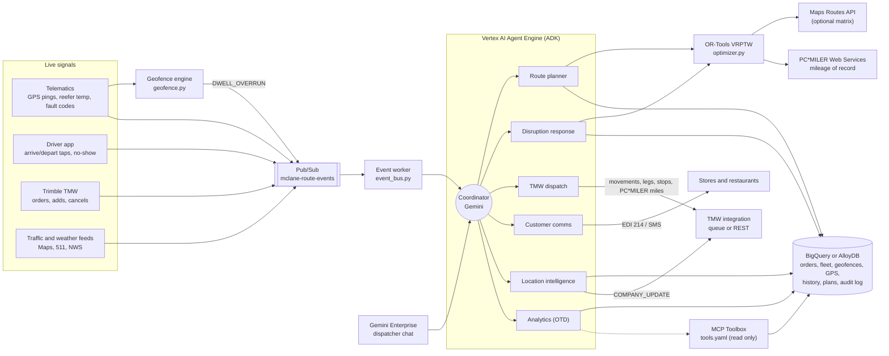
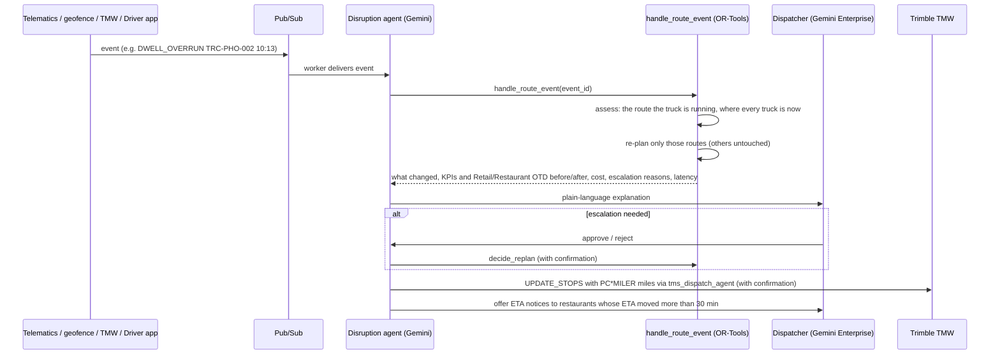

# McLane Dynamic Route Optimization: solution design

This document follows the hackathon prompt's output format: architecture, optimization model, agent workflow, demo script with before/after KPIs, then risks and next steps.

**Context.** McLane runs grocery DCs, which serve convenience stores, grocery and mass merchants, and foodservice DCs, which serve QSR and casual-dining chains. Its private fleet pulls 3-compartment multi-temperature trailers. Trimble TMW (TMW.Suite) is the TMS of record, most routes are fixed, territory-based "static" routes kept in TMW, and Trimble PC*MILER is the mileage of record that TMW rates, pays and bills on. The synthetic network in this repo has 4 DCs, 400 customers (each with a geofence), 81 tractors, 89 drivers, about 180 to 250 stops per day, 60 days of geofence-timestamped delivery history and GPS pings for the first operating day.

**McLane specifics in this build**

| Topic | What the agent does | Where |
|---|---|---|
| PC*MILER mileage | Every saved route, plan total, what-if and TMW payload carries PC*MILER practical miles (`lgh_miles`, `stp_lgh_mileage`). Live PC*MILER Web Services when `PCMILER_API_KEY` is set, otherwise an offline emulation labelled `PCMILER_EMULATED`. `TRAVEL_PROVIDER=pcmiler` also builds the solver matrix from PC*MILER. | `route_optimizer/pcmiler.py` |
| Geolocations | Customer coordinates carry a geocode source and confidence. The agent compares them with where trucks actually park (telematics stop detection) and flags bad geocodes, typically ZIP centroids. | `validate_customer_geolocations` |
| Geofence | A circle around every customer and DC. The geofence engine turns GPS pings into arrivals, departures and dwell, finds trucks still on site, and flags planned stops with no geofence arrival. | `route_optimizer/geofence.py`, `detect_geofence_events` |
| Dwell time change | Recent dwell (last 14 days) versus the customer's own history and the TMW standard. The planner switches to the recent p75 straight away, and the agent recommends the new TMW standard. A truck stuck at a dock raises a `DWELL_OVERRUN` event that is re-planned like a delay. | `analyze_dwell_time_changes`, `learned_service_minutes` |
| Retail and Restaurant OTD | Retail is on time by the receiving window close. Restaurant is on time within ±30 minutes of the scheduled time and inside the window. Reported separately against 95% and 98% targets in plans, re-plans, today's geofence arrivals and 60-day analytics. | `route_optimizer/otd.py`, `get_otd_by_segment` |
| Master-data fixes | Recommended dwell standards and corrected geocodes are applied for planning and queued to TMW as `COMPANY_UPDATE` messages, after confirmation. | `apply_master_data_updates` |

---

## 1. Solution architecture



* **Gemini Enterprise** is the dispatcher's front door. The ADK agent runs on Vertex AI Agent Engine and is registered in Gemini Enterprise as a custom agent (`deployment/register_gemini_enterprise.sh`).
* **ADK multi-agent system** (`route_optimizer/agent.py`). A coordinator delegates to six specialists, each with a narrow tool set:

  | Agent | Job | Key tools |
  |---|---|---|
  | `route_planner_agent` | Daily plan, what-ifs, comparison with TMW static routes | `get_delivery_demand`, `get_fleet_availability`, `optimize_routes`, `run_what_if_scenarios`, `get_route_plan` |
  | `disruption_agent` | Real-time events: trigger, assess, re-plan, explain, approve | `handle_route_event`, `simulate_route_event`, `get_pending_escalations`, `decide_replan` (confirmation), `assess_disruption_impact`, `reoptimize_route_in_flight`, `get_vehicle_locations` |
  | `tms_dispatch_agent` | TMW movements, leg headers and stops with PC*MILER miles | `build_tmw_dispatch_payload`, `submit_plan_to_tmw` (confirmation), `get_dispatch_status` |
  | `customer_comms_agent` | ETA notices (EDI 214 or SMS) | `draft_eta_notifications`, `send_eta_notifications` (confirmation) |
  | `location_intelligence_agent` | GPS positions, geofence arrivals and dwell, dwell changes, geocodes, master-data fixes | `get_vehicle_locations`, `detect_geofence_events`, `analyze_dwell_time_changes`, `validate_customer_geolocations`, `apply_master_data_updates` (confirmation) |
  | `analytics_agent` | Retail and Restaurant OTD, unload-time gaps, savings, network roll-up, BigQuery NL2SQL | `get_otd_by_segment`, `get_delivery_kpis`, `list_optimization_runs`, `get_network_savings_summary`, ADK `BigQueryToolset` (read only), MCP Toolbox tools when `TOOLBOX_URL` is set |

* **Solver.** Google OR-Tools routing (`route_optimizer/optimizer.py`). Gemini never does route arithmetic. It calls tools, and the tools return structured results it explains. Google Cloud's Route Optimization API is a drop-in alternative behind the same `solve()` interface.
* **Travel matrix.** Offline and deterministic by default (great-circle distance × 1.22 circuity, urban and highway speeds). `TRAVEL_PROVIDER=pcmiler` uses PC*MILER truck miles, `TRAVEL_PROVIDER=google_routes` the Maps Routes API `computeRouteMatrix` in 25×25 blocks.
* **Mileage of record.** Whatever the matrix, `pcmiler.stamp_routes` prices each final stop sequence with one PC*MILER route report per route, so TMW gets the miles it rates and pays on.
* **Data.** BigQuery for analytics and NL2SQL, or AlloyDB for transactional plan writes. Both run from one schema definition (`route_optimizer/db/schema.py`, 23 tables). SQLite runs the demo offline. `tools.yaml` exposes read-only SQL through MCP Toolbox for Databases, for the agent and for Antigravity.
* **Events.** Producers publish JSON events to Pub/Sub. `python -m route_optimizer.event_bus worker` stores each one and asks the coordinator to handle it, or calls the tool directly with `--no-llm`. The geofence engine adds `DWELL_OVERRUN` events from GPS.
* **Audit.** Every run and every event action is logged: `optimization_runs`, `event_actions` (cost impact, late stops before and after, escalation reasons, latency), `replan_approvals`, `geofence_events`, `master_data_updates`, `tmw_dispatch_queue` and `customer_notifications`.

## 2. Optimization model

**Decision.** Assign each order to a truck and sequence the stops, choosing departure times.

**Objective (minimize, in cents).**

```
  Σ route fixed cost                       (per truck dispatched, $185)
+ Σ miles × (cost per mile + fuel $/gal ÷ mpg)
+ Σ route span minutes × driver $/min      (prices waiting at the DC and at stores)
+ Σ minutes late × $4                      (soft receiving windows)
+ Σ penalty for orders not delivered       (HOT $1M ≫ STANDARD $25k × tier weight ≫ FLEX $400)
```

Reported cost uses the same simulator for the optimized plan and the TMW static plan, with overtime after 10 hours (1.5×) and a late-stop penalty ($150 grocery, $225 foodservice). Reported miles are PC*MILER miles for both plans.

**Hard constraints (never violated).**

| Constraint | How it is modeled |
|---|---|
| Capacity: cases, weight, cube | Three capacity dimensions per vehicle |
| Temperature zones | `Cold` capacity dimension: chill + frozen cases ≤ trailer cold capacity (0 for dry vans and for a failed reefer) |
| Driver HOS | Route span ≤ remaining 14 h on-duty; `Drive` dimension ≤ remaining 11 h driving |
| Max route duration | `MAX_ROUTE_HOURS` (default 13) caps the span on top of HOS |
| Dispatch window | Departure inside the DC's dispatch window and after the driver's shift start |
| Dock appointments | `customers.hard_window = true` (mass merchants, tier-1 grocery): arrival ≤ window close |
| Site restrictions | Liftgate required and maximum vehicle length restrict which trucks can serve a stop |
| Product on board | During re-plans, a stop is pinned to the truck that carries its product |

**Soft constraints.** Ordinary receiving windows can close up to 60 minutes late (240 during re-plans), with a per-minute penalty. FLEX orders may slide to the next delivery day.

**Learned inputs.** Unload time is the p75 of each customer's geofence dwell (entry to exit), not the TMS master-data value. When a customer has at least 4 visits in the last 14 days, those recent visits win, so a dwell change shows up in the next plan rather than after 60 days. In the synthetic data, TMW underestimates unload time for 77 of 110 Temple customers by 13.4 minutes on average.

**OTD rules.** `otd_policies` holds the definitions. Retail: arrival (geofence entry, else driver app) no later than the window close. Restaurant: within ±30 minutes of the scheduled time and no later than the window close. A new plan is judged on windows (its ETAs become the schedule); a re-plan is judged against the ETAs restaurants were already given.

**Search.** Parallel cheapest insertion, then guided local search with a time budget: 15 s for daily planning, 2 s for a single-truck re-plan, and 8 s for a multi-truck re-plan.

## 3. Agent workflow: trigger, assess, re-plan, explain, approve



| Event | Trigger rule | Re-plan behavior |
|---|---|---|
| `DELAY` | Re-plan only if ≥ `DELAY_TRIGGER_MIN` (15) | Re-sequence that truck from its position, with the delay added |
| `DWELL_OVERRUN` | Geofence: truck still on site ≥ 15 min past the planned unload time | Re-plan that truck from the customer's dock with the expected extra minutes |
| `BREAKDOWN` | Always | Spare tractor drives out and hooks the trailer (product stays on it); re-sequence from the breakdown point; rescue cost added |
| `REEFER_TEMP_ALERT` | Above `REEFER_MAX_TEMP_F` (10°F) | Failed trailer gets 0 cold capacity; cold product is re-picked onto a spare reefer unit; always escalated (food safety) |
| `ORDER_ADDED` | Always | Only trucks still at the DC or a spare unit can take it; existing stops stay pinned |
| `ORDER_CANCELLED` / `NO_SHOW` | Always | Remove the stop, re-sequence; a no-show is rebooked for the next delivery day |
| `ROAD_CLOSURE` | Always | Every route with remaining legs through the closure is re-sequenced |

Telematics and geofence events carry the route the truck is actually running, so they re-plan that route even if a newer plan exists for the same day.

**Escalation to a human** happens when an SLA breach is unavoidable (late at a dock appointment or a tier-1 account), when an order cannot be delivered today, when the cost impact exceeds `ESCALATION_COST_USD` ($750), or always for reefer alerts. Otherwise the change is auto-applied and logged.

**Minimal disruption.** Only affected routes are re-planned, and every result reports `untouched_routes`. In-flight trucks keep their own product.

**Latency.** Measured on every event: 2 s for single-truck events and about 8 s for multi-truck events, against a 30 s target.

## 4. Demo script (5 minutes)

Run `uv run python scripts/demo_run.py` beforehand to warm up and to have the numbers ready. In `uv run adk web .` or Gemini Enterprise, type the prompts in bold.

| Time | Step | What to show |
|---|---|---|
| 0:00 | Frame the problem | "McLane plans routes in TMW as fixed territories, on PC*MILER miles. Windows, unload times and traffic change every day." |
| 0:20 | **"Build the optimized plan for DC-TEMPLE-TX on 2026-10-27 and compare it with the TMW static routes."** | 70 orders, 18.5k cases. 15 → 14 trucks, 2,272 → 1,697 PC*MILER miles, $11,164 → $8,896, Retail planned OTD 100%. The agent explains learned unload times and the I-35 closure. |
| 1:10 | **"Do the same for every DC and give me the network roll-up."** | The network table below. |
| 1:40 | **"The tractor on route …-R09 just broke down at 07:40. What do we do?"** | Spare tractor TRC-TEM-002 hooks the trailer in 92 minutes. Stops re-sequenced, late stops 2 → 0, 13 routes untouched, $312 cost impact, re-planned in 2.0 s, auto-applied. |
| 2:30 | **"Where are the Phoenix trucks right now, and is anyone stuck at a dock?"** (as of 10:30) | Location agent: TRC-PHO-002 has been inside the Sub Station 66 #6208 geofence for 70 min against 41 planned. Four planned stops have no geofence arrival, all ZIP-centroid geocodes. Restaurant OTD today 88.9% vs 98% target. |
| 3:10 | **"Handle the dwell overrun."** | Re-plans route R-20261027-PHO-S02 in 2.0 s. One restaurant moves from 10:12 to 10:49, more than 30 min from its promised ETA, so the agent offers an ETA notice. |
| 3:40 | **"Which Temple customers changed dwell time lately? Fix their TMW standards."** | 14 customers changed (12 longer, 2 shorter), 1,703 unplanned minutes a week. For example Prairie Foods #8182: 58.5 → 98 min, TMW standard 37 → recommend 105. Confirmation dialog, then `COMPANY_UPDATE` messages queued. |
| 4:15 | **"How do Retail and Restaurant OTD compare over the last 60 days?"** | Retail 99.5% vs 95% target, Restaurant 83.8% vs 98%, mostly late (680 late vs 26 early misses), led by traffic. |
| 4:40 | **"Send the updated stops to TMW."** | TMW `UPDATE_STOPS` preview with `lgh_miles` in PC*MILER miles, confirmation, queued message ids. |

**Before/after KPIs** (synthetic data, 2026-10-27, from `scripts/demo_run.py`; miles are PC*MILER practical miles, emulated offline):

| DC | Trucks | PC*MILER miles | Cost ($) | On-time % |
|---|---|---|---|---|
| DC-CONCORD-NC | 16 → 15 | 1,552 → 1,353 | 9,222 → 8,168 | 96.6 → 100 |
| DC-DALLAS-TX | 8 → 8 | 608 → 548 | 6,459 → 4,584 | 78.4 → 97.3 |
| DC-PHOENIX-AZ | 9 → 8 | 803 → 614 | 8,057 → 4,653 | 71.4 → 100 |
| DC-TEMPLE-TX | 15 → 14 | 2,272 → 1,697 | 11,164 → 8,896 | 95.7 → 100 |
| **Network** | **48 → 45** | **5,235 → 4,212 (−19.5%)** | **34,902 → 26,300 (−24.6%)** | **88.0 → 99.5** |

The baseline is the TMW static routes re-priced with the same travel, traffic and learned unload-time model. Its cost includes late penalties, which explains the large foodservice gap. Routing-matrix miles for the same plans are 5,315 → 4,287. Results vary slightly with the solver time limit.

**Planned and actual OTD.** Planned OTD of the optimized plans: Retail 100% (Concord, Temple), Restaurant 97.3% (Dallas) and 100% (Phoenix). Over the last 60 days of geofence history: Retail 99.5% against a 95% target, Restaurant 83.8% against 98%. In this data the OTD gap is a restaurant problem: arrivals drift past the ±30 minute schedule tolerance, which the optimized, dwell-aware plans are built to fix.

**Location data quality.** About 12% of arrivals fall back to the driver app because the geofence missed. Temple has 10 and Phoenix 9 customers whose TMW geocode is 0.5 to 1.6 miles from where trucks park.

**Assumptions** (stated so judges can challenge them):
* Travel times are modeled, not measured, unless the Routes API or PC*MILER matrix is enabled.
* Offline PC*MILER miles are an emulation (great-circle × 1.20 practical circuity with a per-lane adjustment). With a PC*MILER key the same code calls PC*MILER Web Services `route/routeReports`; field names should be confirmed against the account's API version.
* GPS pings exist only for the first operating day and follow the TMW static routes, which is what was dispatched that day.
* Disruptions apply to every leg that crosses the affected area while the event overlaps the plan, which is conservative.
* TMW integration writes TMW-shaped JSON to a queue table and optionally POSTs to `TMW_API_BASE_URL`. The real interface (TMW.Suite APIs or Trimble integration services) needs McLane's endpoint and credentials. The `COMPANY_UPDATE` field for the standard stop time must be mapped to McLane's TMW company profile.

## 5. Risks and next steps

| Risk | Mitigation |
|---|---|
| Model and solver output diverges from reality (travel, unload) | Use PC*MILER or the Routes API for the matrix, feed geofence arrivals and dwell back into `delivery_history`, and track plan-versus-actual error per DC |
| PC*MILER licensing and rate limits | One route report per route (not per pair) for mileage of record; cache by stop sequence; cap the PC*MILER matrix size; fall back to the labelled emulation instead of failing a plan |
| GPS and geocode quality | Measure geofence capture rate per DC, fix geocodes from observed parking spots, and keep driver-app timestamps as the fallback |
| Dispatcher trust, "black box" routes | Every change has a plain-language explanation, KPIs and OTD before and after, an audit trail and a human approval gate. Start in advisory mode (plan only, dispatcher submits) |
| TMW integration effort | Begin with the queue table and a nightly import; move to real-time `UPDATE_STOPS` and `COMPANY_UPDATE` once the endpoint is agreed |
| Driver and store disruption from changing routes daily | Add route consistency (prefer yesterday's driver and stop order) as a soft objective term |
| Food safety and compliance | Reefer events always escalate; HOS and temperature are hard constraints in the solver, not prompt instructions |
| LLM hallucinating numbers | Prompts forbid stating numbers not returned by a tool; temperature is 0.1; tools return all figures |

**Next steps (90-day pilot):**
1. Connect real TMW orders, stops and company master data through a BigQuery replica, PC*MILER Web Services with McLane's key, and telematics GPS through Pub/Sub. Run one DC in advisory mode for 4 weeks.
2. Run the geofence engine on the live ping stream and publish `DWELL_OVERRUN` events; tune radius and exit buffer per site type.
3. Calibrate Retail and Restaurant OTD definitions and targets with the business, and report them daily in Looker over `delivery_history`.
4. Add dock-door capacity at the DC (staggered departures), driver preferences and route-consistency terms.
5. Use BigQuery ML or Vertex AI to forecast dwell and order volume per customer, replacing the recent-p75 rule.
