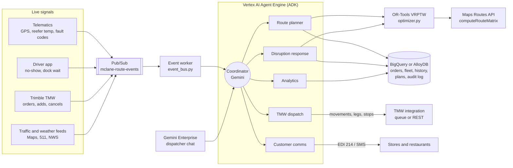
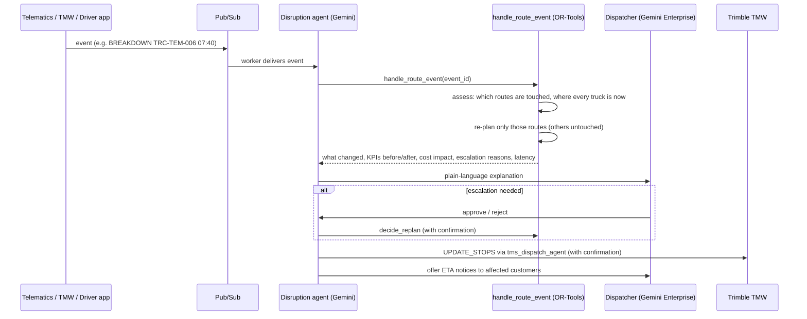

# McLane Dynamic Route Optimization: solution design

This document follows the hackathon prompt's output format: architecture, optimization model, agent workflow, demo script with before/after KPIs, then risks and next steps.

**Context.** McLane runs grocery DCs, which serve convenience stores, grocery and mass merchants, and foodservice DCs, which serve QSR and casual-dining chains. Its private fleet pulls 3-compartment multi-temperature trailers. Trimble TMW (TMW.Suite) is the TMS of record, and most routes are fixed, territory-based "static" routes kept in TMW. The synthetic network in this repo has 4 DCs, 400 customers, 81 tractors, 89 drivers and about 180 to 250 stops per day.

---

## 1. Solution architecture



* **Gemini Enterprise** is the dispatcher's front door. The ADK agent runs on Vertex AI Agent Engine and is registered in Gemini Enterprise as a custom agent (`deployment/register_gemini_enterprise.sh`).
* **ADK multi-agent system** (`route_optimizer/agent.py`). A coordinator delegates to five specialists, each with a narrow tool set:

  | Agent | Job | Key tools |
  |---|---|---|
  | `route_planner_agent` | Daily plan, what-ifs, comparison with TMW static routes | `get_delivery_demand`, `get_fleet_availability`, `optimize_routes`, `run_what_if_scenarios`, `get_route_plan` |
  | `disruption_agent` | Real-time events: trigger, assess, re-plan, explain, approve | `handle_route_event`, `simulate_route_event`, `get_pending_escalations`, `decide_replan` (confirmation), `assess_disruption_impact`, `reoptimize_route_in_flight` |
  | `tms_dispatch_agent` | TMW movements, leg headers and stops | `build_tmw_dispatch_payload`, `submit_plan_to_tmw` (confirmation), `get_dispatch_status` |
  | `customer_comms_agent` | ETA notices (EDI 214 or SMS) | `draft_eta_notifications`, `send_eta_notifications` (confirmation) |
  | `analytics_agent` | On-time %, unload-time gaps, savings, network roll-up, BigQuery NL2SQL | `get_delivery_kpis`, `list_optimization_runs`, `get_network_savings_summary`, ADK `BigQueryToolset` (read only) |

* **Solver.** Google OR-Tools routing (`route_optimizer/optimizer.py`). Gemini never does route arithmetic. It calls tools, and the tools return structured results it explains. Google Cloud's Route Optimization API is a drop-in alternative behind the same `solve()` interface.
* **Travel times.** These are offline and deterministic by default (great-circle distance × 1.22 circuity, urban and highway speeds). Set `TRAVEL_PROVIDER=google_routes` to use the Maps Routes API `computeRouteMatrix` in 25×25 blocks.
* **Data.** BigQuery for analytics and NL2SQL, or AlloyDB for transactional plan writes. Both run from one schema definition (`route_optimizer/db/schema.py`). SQLite runs the demo offline.
* **Events.** Producers publish JSON events to Pub/Sub. `python -m route_optimizer.event_bus worker` stores each one and asks the coordinator to handle it, or calls the tool directly with `--no-llm`.
* **Audit.** Every run and every event action is logged: `optimization_runs`, `event_actions` (cost impact, late stops before and after, escalation reasons, latency), `replan_approvals`, `tmw_dispatch_queue` and `customer_notifications`.

## 2. Optimization model

**Decision.** Assign each order to a truck and sequence the stops, choosing departure times.

**Objective (minimize, in cents).**

```
  Σ route fixed cost                       (per truck dispatched, $185)
+ Σ miles × (cost per mile + fuel $/gal ÷ mpg)
+ Σ route span minutes × driver $/min      (prices waiting at the DC and at stores)
+ Σ minutes late × $4                      (soft receiving windows)
+ Σ penalty for orders not delivered       (HOT $1M ≫ STANDARD $25k × tier weight ≫ FLEX $400)
```

Reported cost uses the same simulator for the optimized plan and the TMW static plan, with overtime after 10 hours (1.5×) and a late-stop penalty ($150 grocery, $225 foodservice).

**Hard constraints (never violated).**

| Constraint | How it is modeled |
|---|---|
| Capacity: cases, weight, cube | Three capacity dimensions per vehicle |
| Temperature zones | `Cold` capacity dimension: chill + frozen cases ≤ trailer cold capacity (0 for dry vans and for a failed reefer) |
| Driver HOS | Route span ≤ remaining 14 h on-duty; `Drive` dimension ≤ remaining 11 h driving |
| Max route duration | `MAX_ROUTE_HOURS` (default 13) caps the span on top of HOS |
| Dispatch window | Departure inside the DC's dispatch window and after the driver's shift start |
| Dock appointments | `customers.hard_window = true` (mass merchants, tier-1 grocery): arrival ≤ window close |
| Site restrictions | Liftgate required and maximum vehicle length restrict which trucks can serve a stop |
| Product on board | During re-plans, a stop is pinned to the truck that carries its product |

**Soft constraints.** Ordinary receiving windows can close up to 60 minutes late (240 during re-plans), with a per-minute penalty. FLEX orders may slide to the next delivery day.

**Learned inputs.** Unload time is the p75 of each customer's actual dwell over 60 days, not the TMS master-data value. In the synthetic data, TMW underestimates unload time for 81 of 110 Temple customers by 11.6 minutes on average.

**Search.** Parallel cheapest insertion, then guided local search with a time budget: 15 s for daily planning, 2 s for a single-truck re-plan, and 8 s for a multi-truck re-plan.

## 3. Agent workflow: trigger, assess, re-plan, explain, approve



| Event | Trigger rule | Re-plan behavior |
|---|---|---|
| `DELAY` | Re-plan only if ≥ `DELAY_TRIGGER_MIN` (15) | Re-sequence that truck from its position, with the delay added |
| `BREAKDOWN` | Always | Spare tractor drives out and hooks the trailer (product stays on it); re-sequence from the breakdown point; rescue cost added |
| `REEFER_TEMP_ALERT` | Above `REEFER_MAX_TEMP_F` (10°F) | Failed trailer gets 0 cold capacity; cold product is re-picked onto a spare reefer unit; always escalated (food safety) |
| `ORDER_ADDED` | Always | Only trucks still at the DC or a spare unit can take it; existing stops stay pinned |
| `ORDER_CANCELLED` / `NO_SHOW` | Always | Remove the stop, re-sequence; a no-show is rebooked for the next delivery day |
| `ROAD_CLOSURE` | Always | Every route with remaining legs through the closure is re-sequenced |

**Escalation to a human** happens when an SLA breach is unavoidable (late at a dock appointment or a tier-1 account), when an order cannot be delivered today, when the cost impact exceeds `ESCALATION_COST_USD` ($750), or always for reefer alerts. Otherwise the change is auto-applied and logged.

**Minimal disruption.** Only affected routes are re-planned, and every result reports `untouched_routes`. In-flight trucks keep their own product.

**Latency.** Measured on every event: 2 s for single-truck events and about 8 s for multi-truck events, against a 30 s target.

## 4. Demo script (5 minutes)

Run `python scripts/demo_run.py` beforehand to warm up and to have the numbers ready. In `adk web` or Gemini Enterprise, type the prompts in bold.

| Time | Step | What to show |
|---|---|---|
| 0:00 | Frame the problem | "McLane plans routes in TMW as fixed territories. Windows, unload times and traffic change every day." |
| 0:30 | **"What does tomorrow look like for Temple?"** | The demand and fleet summary: 70 orders, 18.5k cases (6.3k cold), 2 HOT orders, 20 units. |
| 1:00 | **"Build the optimized plan for DC-TEMPLE-TX on 2026-10-27 and compare it with the TMW static routes."** | 15 → 14 trucks, 2,306 → 2,016 miles, $10,962 → $9,309, 3 late stops → 0. The agent explains learned unload times and the I-35 closure. |
| 2:00 | **"Do the same for every DC and give me the network roll-up."** | The network table below. |
| 2:45 | **"The tractor on route …-R06 just broke down at 07:40. What do we do?"** | Spare tractor TRC-TEM-008 hooks the trailer in 106 minutes. Five stops re-sequenced, late stops 1 → 0, 13 routes untouched, $320 cost impact, re-planned in 2.0 s, auto-applied. |
| 3:45 | **"Dallas truck R04 reports frozen zone at 18°F."** | Cold product re-picked onto a spare reefer; dry continues. Late or failed stops 6 → 1, +$651. Escalated for food safety, so the dispatcher approves in chat (confirmation dialog). |
| 4:30 | **"Send the updated stops to TMW and notify the affected stores."** | TMW `UPDATE_STOPS` payload preview, confirmation, queued message ids; ETA notice drafts. |

**Before/after KPIs** (synthetic data, 2026-10-27, from `scripts/demo_run.py`):

| DC | Trucks | Miles | Cost ($) | On-time % |
|---|---|---|---|---|
| DC-CONCORD-NC | 15 → 15 | 1,512 → 1,378 | 8,685 → 8,083 | 98.3 → 100 |
| DC-DALLAS-TX | 8 → 8 | 604 → 563 | 6,964 → 4,381 | 73.0 → 100 |
| DC-PHOENIX-AZ | 9 → 8 | 819 → 626 | 7,702 → 4,548 | 73.8 → 100 |
| DC-TEMPLE-TX | 15 → 14 | 2,306 → 2,016 | 10,962 → 9,309 | 95.7 → 100 |
| **Network** | **47 → 45** | **5,240 → 4,582 (−12.6%)** | **34,313 → 26,321 (−23.3%)** | **88.0 → 100** |

The baseline is the TMW static routes re-priced with the same travel, traffic and learned unload-time model. Its cost includes late penalties, which explains the large foodservice gap. Results vary slightly with the solver time limit.

**Assumptions** (stated so judges can challenge them):
* Travel times are modeled, not measured, unless the Maps Routes API is enabled.
* The truck's position during an event is its last completed stop. With real telematics, use the GPS ping.
* Disruptions apply to every leg that crosses the affected area while the event overlaps the plan, which is conservative.
* TMW integration writes TMW-shaped JSON to a queue table and optionally POSTs to `TMW_API_BASE_URL`. The real interface (TMW.Suite APIs or Trimble integration services) needs McLane's endpoint and credentials.

## 5. Risks and next steps

| Risk | Mitigation |
|---|---|
| Model and solver output diverges from reality (travel, unload) | Use the Routes API for the matrix, feed actual arrival and dwell back into `delivery_history`, and track plan-versus-actual error per DC |
| Dispatcher trust, "black box" routes | Every change has a plain-language explanation, KPIs before and after, an audit trail and a human approval gate. Start in advisory mode (plan only, dispatcher submits) |
| TMW integration effort | Begin with the queue table and a nightly import; move to real-time `UPDATE_STOPS` once the endpoint is agreed |
| Driver and store disruption from changing routes daily | Add route consistency (prefer yesterday's driver and stop order) as a soft objective term |
| Food safety and compliance | Reefer events always escalate; HOS and temperature are hard constraints in the solver, not prompt instructions |
| LLM hallucinating numbers | Prompts forbid stating numbers not returned by a tool; temperature is 0.1; tools return all figures |

**Next steps (90-day pilot):**
1. Connect real TMW orders, stops and master data through a BigQuery replica, and telematics through Pub/Sub. Run one DC in advisory mode for 4 weeks.
2. Switch the travel matrix to the Routes API with traffic-aware departure times, and calibrate the cost model with finance.
3. Add dock-door capacity at the DC (staggered departures), driver preferences and route-consistency terms.
4. Use BigQuery ML or Vertex AI to forecast unload time and order volume per customer, replacing the p75 rule.
5. Integrate with TMW for write-back, plus a Looker dashboard over `optimization_runs` and `event_actions`.
