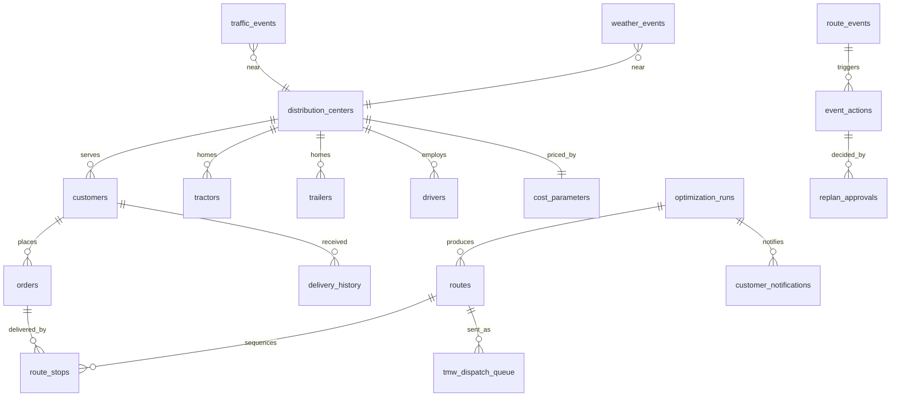

# Data model

The authoritative definition, with column descriptions, is `route_optimizer/db/schema.py`. Rendered DDL is in
`data/schema/`.

| Table | Rows (seed 27) | Notes |
|---|---|---|
| distribution_centers | 4 | 2 grocery (Temple TX, Concord NC), 2 foodservice (Dallas TX, Phoenix AZ) |
| customers | 400 | segment, receiving window, standard unload time, hard window, liftgate, max length, tier |
| tractors / trailers | 81 / 81 | multi-temp 53', dry 53', 26' straight reefers with liftgate |
| drivers | 89 | HOS remaining, shift start, PTO |
| orders | 1,256 | 7 days from 2026-10-27; dry, chill and frozen cases; HOT / STANDARD / FLEX |
| routes / route_stops | 300 / 1,250 | TMW static baseline, plus agent output appended at run time |
| delivery_history | ~10.7k | 60 days of planned versus actual arrival, dwell and exception code |
| traffic_events / weather_events | 27 / 4 | closures, accidents, construction, AM peaks; storms, fog, dust, flood |
| route_events | 8 | demo events on 2026-10-27 |
| cost_parameters | 4 | per-mile, fuel, driver wage, overtime, fixed, late penalty, CO2 |
| optimization_runs, event_actions, replan_approvals, tmw_dispatch_queue, customer_notifications | 0 | written by the agents (audit) |
